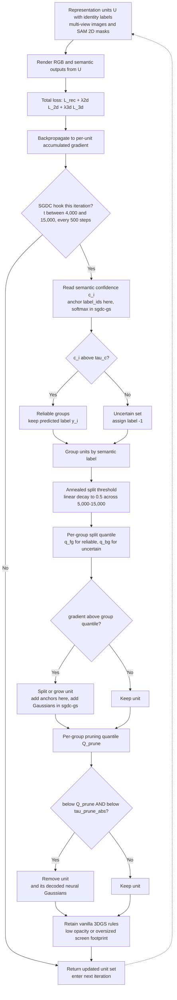

# Semantic-Guided Density Control for Compact Semantic 3D Gaussian Splatting

Anchor-based instantiation of SGDC, built on top of [ObjectGS](https://github.com/RuijieZhu94/ObjectGS/). The primitive-based instantiation on Gaussian Grouping is available at [sgdc-gs](https://github.com/yuweidong/sgdc-gs).

## Technical roadmap

SGDC is a density-control hook inside the training loop, not a new network and not a change to the rasterizer. Between iteration 4,000 and 15,000 it runs every 500 iterations. Each pass reads two quantities for every representation unit: the semantic confidence `c_i` and the accumulated gradient. It then applies three decisions in a fixed order and returns the updated unit set `U'` to the next iteration. A unit is an anchor in this repository and an individual Gaussian in the companion primitive-based repository. All three decisions consume the same confidence and gradient, so the diagram below is one pass of a single controller rather than three independent algorithms.



Three stages, in the order they execute:

1. **Confidence-guided semantic labelling** (Eq. 5). Units whose confidence reaches `tau_c` keep their predicted label and form the reliable groups. The rest are assigned label `-1` and collected into one uncertain set. This keeps semantic bleeding out of densification: uncertain boundary and background units no longer compete with reliable semantic groups for the same splitting budget.

2. **Semantic adaptive splitting with annealing** (Eq. 7). For each group the controller computes a gradient quantile, using `q_fg` for reliable groups and `q_bg` for the uncertain set. A unit grows when its gradient exceeds that group's quantile, under an effective threshold that decays linearly to half its initial value between iterations 5,000 and 15,000. Early iterations therefore build coarse structure and later iterations add fine detail.

3. **Gradient-aware pruning** (Eq. 8). A unit is removed only when its gradient is both below its group's pruning quantile `Q_prune` and below the absolute bound `tau_prune_abs`. The quantile locates redundant units within a group, while the absolute bound protects flat regions such as walls and sky from being emptied. The original 3DGS rules, low opacity and oversized screen-space footprint, are retained on top.

| Stage | Paper | Where it lives in this repository |
| --- | --- | --- |
| Labelling | Eq. 5 | `compute_semantic_labels` in `semantic_density_control.py` reads hard `label_ids`; background 0 becomes label `-1` |
| Splitting and annealing | Eq. 7 | `_get_current_split_threshold` plus the split branch of `compute_split_prune_masks` |
| Pruning | Eq. 8 | `inst_prune` in `compute_split_prune_masks` combines the group quantile with `prune_abs_threshold` |
| Hook scheduling | Algorithm 1 | `train.py` injects both masks into `run_densify` through `ext_split_mask` and `ext_prune_mask`; after iteration 15,000 only the opacity path runs |

Threshold values differ across the three datasets and between the two backbones, so the diagram uses symbols rather than numbers. The values this repository actually uses are listed in [Full SGDC configuration](#full-sgdc-configuration). Relative quantiles and the annealing schedule are shared, while absolute gradient bounds are recalibrated per dataset. On LERF-Mask, Replica and Mip-NeRF 360, the paper reports a 33.5-61.0% reduction in representation units while preserving rendering quality.


## Installation

1. Clone the repository locally:

```bash
git clone https://github.com/ZehuiWU2009/sgdc-objectgs
```

2. Install dependencies:
```bash
cd sgdc-objectgs
conda env create --file environment.yml
```

3. Install customized gsplat:

**❗️❗️❗️Attention: You should install the [customized gsplat](https://github.com/RuijieZhu94/gsplat-object), instead of the original gsplat.**

If compilation fails, you will likely need to install `libglm-dev`:

```bash
sudo apt-get install libglm-dev
# then reinstall gsplat-object
pip install git+https://github.com/RuijieZhu94/gsplat-object.git
```

## Preparing the data

- **Download**: You can download the LERF-Masked dataset from this [link](https://huggingface.co/mqye/Gaussian-Grouping/tree/main/data/lerf_mask).

- **Preprocessing**: Please refer to [PLY_PREPROCESSING_README.md](PLY_PREPROCESSING_README.md) for detailed usage.

## Training and Evaluate

### LERF-Mask
#### Ramen scene
```bash
python train.py --config config/objectgs/3d/lerf_mask/config.yaml --scene_name ramen
python render_lerf_mask.py -m path/to/your/training/folder  --skip_train
python eval_lerf_mask.py ramen --pred_path path/to/your/training/folder
python metrics.py -m path/to/your/training/folder
```

#### Figurines scene
```bash
python train.py --config config/objectgs/3d/lerf_mask/config.yaml --scene_name figurines
python render_lerf_mask.py -m path/to/your/training/folder  --skip_train
python eval_lerf_mask.py figurines --pred_path path/to/your/training/folder
python metrics.py -m path/to/your/training/folder
```

#### Teatime scene
```bash
python train.py --config config/objectgs/3d/lerf_mask/config.yaml --scene_name teatime
python render_lerf_mask.py -m path/to/your/training/folder  --skip_train
python eval_lerf_mask.py teatime --pred_path path/to/your/training/folder
python metrics.py -m path/to/your/training/folder
```

### Mip-NeRF 360
```bash
python train.py --config config/objectgs/3d/mipnerf360/config.yaml --scene_name counter
python metrics.py -m path/to/your/training/folder
``` 

## Reproducing the reported experiments

All runs take one config file plus a scene name. `train.py` exposes `--config`, `--scene_name`, `--gpu` and logging flags on the command line; values inside `optim_params` cannot be overridden from the shell. Every ablation and sensitivity run therefore starts from a copy of the config file with the relevant lines edited.

The config file is copied into the output folder when training starts. Results are written to `outputs/<dataset_name>/<exp_name>/<scene_name>/<timestamp>`, and `train.py` renders and evaluates at the end of training. The `path/to/your/training/folder` placeholders above refer to this folder. For the numbers in the paper, use the config paths listed below. The Mip-NeRF 360 run in particular needs `config/objectgs/3d/mipnerf360/config.yaml`, whose SGDC thresholds differ from the LERF-Mask ones.

Data setup: `ply_preprocessing.py` writes `points3D_corr.ply`. Place it as `sparse/0/points3D.ply` inside each LERF-Mask and Replica scene folder, and as `points3D.ply` inside the Mip-NeRF 360 scene folder, as expected by `scene/dataset_readers.py`.

### Full SGDC configuration

The full model is the unmodified default of each config file. The values below are read from the three files under `config/objectgs/3d/`. A value marked `*` is forwarded to the controller but has no effect in this anchor-based adapter, which reads hard `label_ids` instead of classifier probabilities.

| Parameter | LERF-Mask | Mip-NeRF 360 | Replica |
| --- | --- | --- | --- |
| `dataset_name` | `lerf_mask` | `mipnerf360` | `replica` |
| `source_path` | `datasets/lerf_mask` | `datasets/mipnerf360` | `datasets/replica` |
| `exp_name` | `rebuttal` | `object_0.01` | `objectgs` |
| `images` | `images` | `images` | `images_all` |
| `resolution` | -1 | 4 | -1 |
| `eval` | False | True | True |
| `iterations` | 30,000 | 30,000 | 30,000 |
| `lambda_object_loss` | 0.01 | 0.001 | 0.1 |
| `densify_grad_threshold` | 5e-5 | 2e-4 | 2e-5 |
| `start_stat` | 500 | 500 | 500 |
| `update_from` | 1,500 | 1,500 | 1,500 |
| `update_interval` | 100 | 100 | 100 |
| `update_until` | 30,000 | 30,000 | 30,000 |
| `min_opacity` | 0.005 | 0.005 | 0.005 |
| `success_threshold` | 0.8 | 0.8 | 0.8 |
| `semantic_density_control_start` | 4,000 | 4,000 | 4,000 |
| `semantic_density_interval` | 500 | 500 | 500 |
| `fixed_split_threshold` | 3e-5 | 5e-6 | 6e-7 |
| `split_quantile` | 0.30 | 0.30 | 0.65 |
| `bg_split_quantile` | 0.95 | 0.95 | 0.95 |
| `prune_quantile` | 0.04 | 0.04 | 0.06 |
| `prune_abs_threshold` | 6e-5 | 1e-4 | 3e-10 |
| `min_points_per_instance` | 5 | 2 | 10 |
| `filter_low_confidence` | 1* | 1* | 1* |
| `confidence_threshold` | 0.7* | 0.7* | 0.7* |
| `anneal_enable` | 1 | 1 | 1 |
| `anneal_start_iter` | 5,000 | 5,000 | 5,000 |
| `anneal_end_iter` | 15,000 | 15,000 | 15,000 |
| `anneal_target_factor` | 0.5 | 0.5 | 0.5 |
| `ablation_instance_split` | 1 | 1 | 1 |
| `ablation_gradient_prune` | 1 | 1 | 1 |
| `ablation_semantic` | 1, hard-coded in `train.py` | same | same |
| `shuffle` in `pipeline_params` | True | True | True |

Absolute gradient thresholds are calibrated per dataset because anchor gradient magnitudes differ by orders of magnitude. The relative quantiles and the annealing schedule are shared. The controller runs from iteration 4,000, every 500 iterations, until iteration 15,000; after that only the opacity pruning path is active.

### Commands for the three scene groups

```bash
# LERF-Mask: three scenes, identical config and parameters
python train.py --config config/objectgs/3d/lerf_mask/config.yaml --scene_name ramen
python train.py --config config/objectgs/3d/lerf_mask/config.yaml --scene_name figurines
python train.py --config config/objectgs/3d/lerf_mask/config.yaml --scene_name teatime

# Mip-NeRF 360: counter, reported in Table 5
python train.py --config config/objectgs/3d/mipnerf360/config.yaml --scene_name counter

# Replica: office_0, reported in Table 6
python train.py --config config/objectgs/3d/replica/config.yaml --scene_name office_0
```

For Replica, `--scene_name` must match the folder name of your scene; the paper reports `office_0`. `train_3d.sh <scene_dir>` iterates over every scene folder and selects the config from the parent folder name. Each run writes to `outputs/lerf_mask/rebuttal/<scene>/<timestamp>`, `outputs/mipnerf360/object_0.01/<scene>/<timestamp>` or `outputs/replica/objectgs/<scene>/<timestamp>`.

### Ablations

Use the `figurines` scene so that the setup matches the ablation scene in the paper. The component tables there were produced with the Gaussian Grouping backbone in the companion `sgdc-gs` repository. The runs below apply the same switches to the anchor-based backbone and are not expected to reproduce those exact numbers.

| Variant | Change relative to a copy of `lerf_mask/config.yaml` |
| --- | --- |
| Full | No change |
| w/o Adaptive | `ablation_instance_split: 0` and `anneal_enable: 0` |
| w/o Prune | `ablation_gradient_prune: 0` |
| w/o Annealing | `anneal_enable: 0` |
| w/o Semantic | Not available from the config: `ablation_semantic` is hard-coded to 1 at the controller construction in `train.py`. Set it to 0 there. |

Do not change `anneal_end_iter` to build an annealing ablation. `train.py` also uses `iteration < opt.anneal_end_iter` as the end of the whole SGDC window, so editing that value silently shortens or extends density control. Use `anneal_enable: 0` instead.

The sensitivity sweeps in the paper use a confidence threshold of 0.3, 0.6 or 0.9 and a pruning quantile of 0.04, 0.06 or 0.08. `prune_quantile` is effective here. `confidence_threshold` is not, because this adapter uses hard labels, so the confidence sweep belongs to the `sgdc-gs` repository.

```bash
mkdir -p config/objectgs/3d/ablation
cp config/objectgs/3d/lerf_mask/config.yaml config/objectgs/3d/ablation/lerf_mask_wo_adaptive.yaml
python - <<'PY'
p = "config/objectgs/3d/ablation/lerf_mask_wo_adaptive.yaml"
s = open(p).read()
s = s.replace("ablation_instance_split: 1", "ablation_instance_split: 0")
s = s.replace("anneal_enable: 1", "anneal_enable: 0")
open(p, "w").write(s)
PY
python train.py --config config/objectgs/3d/ablation/lerf_mask_wo_adaptive.yaml --scene_name figurines
```

### Random seed and reproducibility

All reported runs use seed 0: the full model, every ablation and all three scene groups. `train.py` calls `safe_state()` before training, which sets `random.seed(0)`, `np.random.seed(0)` and `torch.manual_seed(0)` in `utils/general_utils.py`. Camera sampling with `randint` in the training loop and `shuffle: True` in `pipeline_params` are both driven by this seed. There is no `--seed` flag; to run another seed, edit those three lines in `safe_state()` and keep a separate config copy for each run.

`vis_ply.py` uses a separate default seed of 42 for its offline color map, and `train.py` carries an unused copy of that class. Neither is instantiated during training, so the training seed remains 0. `ply_preprocessing.py` maps IDs to colors deterministically and uses no seed. Pass `--gpu 0` explicitly on multi-GPU machines, since the `nvidia-smi` query at the top of `train.py` otherwise picks the least-used device. CUDA atomic operations are not bit-deterministic, so keep the GPU model, driver and `environment.yml` fixed and expect small numerical differences across devices. Every run stores `config.yaml`, `outputs.log` and `train_stats.json` in its output folder; archive them together with the checkpoint.

## Acknowledgements
This project is built upon [3D Gaussian Splatting](https://github.com/graphdeco-inria/gaussian-splatting), [Scaffold-GS](https://github.com/city-super/Scaffold-GS) and [ObjectGS](https://github.com/RuijieZhu94/ObjectGS/) . We gratefully acknowledge the authors for open-sourcing their code and making this research possible.
